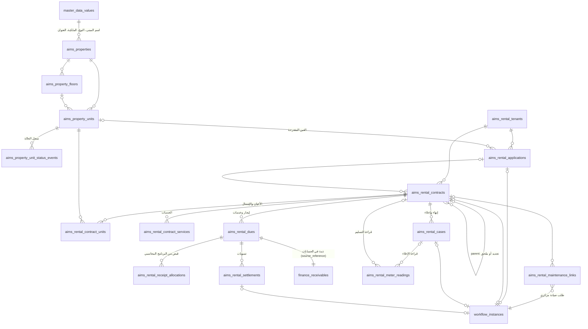

# نموذج البيانات والعلاقات: ملف الأصول والإيجارات

**المصدر:** الجداول كما هي في `al_amal_db` بعد الترحيل `2026_11_17_000001_complete_rentals_module`.

**طبيعة الترحيل:** إضافي فقط، ويرفض العمل إن وُجدت سجلات إيجار. كل الجداول كانت فارغة عند تطبيقه.

**المستندات:** `aims_rental_documents` ترتبط بأي سجل عبر الحقلين `owner_type` و`owner_id`.
- الأنواع المسموحة: أصل، عين، مستأجر، طلب، عقد، معاملة، تسوية، قراءة.
- الإصدارات مسلسلة عبر `supersedes_id`، وهو فريد: لكل مستند إصدار لاحق واحد على الأكثر.
- الملفات على القرص الخاص، وتُنزَّل عبر مسار مخوّل يُسجَّل في التدقيق.

## القيود

| القيد | الجدول | ما يمنعه |
|---|---|---|
| `aims_rental_contract_units_no_overlap` (EXCLUDE gist) | الأعيان في العقود | عقدين يشغلان العين نفسها في فترتين متداخلتين؛ من قاعدة البيانات أيًا كان مسار الكتابة. اختُبر (23P01) |
| `aims_rental_receipts_live_unique` (فريد جزئي) | القبض | احتساب السند نفسه مرتين على الاستحقاق نفسه، ما لم يُعكس |
| `request_key` فريد | القبض | تكرار تسجيل النموذج نفسه عند إعادة الإرسال |
| `aims_rental_dues_item_unique` | الاستحقاقات | تكرار البند نفسه (إيجار، أو خدمة محددة) في التاريخ نفسه |
| `aims_rental_tenants_identity_unique` | المستأجرون | ملف مكرر لنفس رقم الهوية أو التسجيل؛ المقارنة تتجاهل حالة الأحرف والمسافات |
| `aims_rental_contracts_open_successor` | العقود | أكثر من تجديد أو ملحق مفتوح لنفس العقد |
| قيود CHECK (17 قيدًا) | كل الجداول | حالات خارج القائمة، مبالغ ≤ 0، تواريخ مقلوبة، تجديد أو ملحق بلا عقد أصلي، خدمة منفصلة بلا قيمة |
| المفاتيح الخارجية | كل العلاقات | `RESTRICT`: لا حذف متسلسل؛ السجل المرجعي لا يُحذف |

## الحالات (رموز نظام بقيود CHECK)

- **العين:** قيد الإعداد، شاغرة، محجوزة، مؤجرة، تحت الصيانة، موقوفة، غير قابلة للتأجير.
- **العقد:** مسودة، بانتظار الاعتماد، مُعاد، معتمد، فعال، منتهي المدة، مُجدَّد، مستبدل بملحق، مُنهى، مرفوض، ملغى.
- **الاستحقاق:** مفتوح، مغلق، ملغى.
  - حالة السداد تُحسب ولا تُخزَّن: مسدد، جزئي، غير مسدد، متأخر.
- **الطلب والإنهاء والتسوية:** مسودة، قيد المراجعة، مُعاد، معتمد، مرفوض، مكتمل أو مُرحّل، ملغى.

## مصدر كل رقم مالي

| الرقم | المصدر |
|---|---|
| المستحق الأصلي | `aims_rental_dues.amount` (لا يتغير بالتحصيل) |
| المقبوض | مخصصات القبض غير المعكوسة، مضافًا إليها سندات AIMS المنفذة في الوضع المحاسبي الكامل (`finance_payment_allocations`) |
| التسويات | `aims_rental_settlements` بالحالة `posted` فقط |
| المتبقي | الصافي − المقبوض، ولا يقل عن صفر؛ الزيادة رصيد دائن للمستأجر |

الصافي = المستحق الأصلي ± التسويات المرحّلة. الصيغة في [RentalLedger.php](../../app/Services/Rentals/RentalLedger.php).
